<!-- @format -->

# Mini Git

Python으로 만든 이지영의 버전 관리 학습 프로젝트입니다. 터미널에 명령어를 입력해 작업 기록인 커밋을 만들고, 브랜치로 기록을 나누며, 원하는 기록을 검색하거나 연결 관계를 확인할 수 있습니다. 외부 패키지와 그래프 전용 라이브러리는 사용하지 않았습니다.

## 1. 개발 목적과 학습 범위

Git의 커밋과 브랜치가 어떻게 연결되는지 이해하기 위해 만든 프로젝트입니다. 커밋은 메시지·작성자·시간·이전 기록과의 연결을 담은 기록 한 개이고, 브랜치는 특정 커밋을 가리키는 작업 갈래의 이름입니다. 파일 내용 자체가 아니라 기록을 설명하는 정보인 메타데이터를 저장합니다.

```text
사용자 명령 입력
  → shlex로 명령과 인자 분리
  → 명령·인자·저장소 상태 확인
  → 커밋·브랜치 변경 또는 탐색·검색·정렬
  → 실행 결과 출력
  → 다음 명령 대기
```

커밋 사이의 연결을 따라가 이전 기록을 찾거나 다른 갈래까지의 경로를 확인할 수 있습니다. 기록을 빠르게 찾기 위해 해시맵을, 가장 짧은 경로를 찾기 위해 BFS를, 모든 이전 기록을 찾기 위해 DFS를 사용합니다. 각 자료구조와 알고리즘의 의미는 아래 코드와 실행 결과에 연결해 설명합니다.

## 2. 개발 환경과 실행 조건

| 구분             | 내용                                              |
| ---------------- | ------------------------------------------------- |
| 언어             | Python 3.10 이상                                  |
| 실행 환경        | Python을 실행할 수 있는 터미널                    |
| 실행 명령        | `python3 main.py`                                 |
| 인터페이스       | `mini-git>` 프롬프트의 REPL                       |
| 사용 모듈        | collections, dataclasses, datetime, shlex, typing |
| 테스트           | Python 표준 라이브러리 unittest                   |
| 데이터 저장      | 실행 중 메모리                                    |
| 외부 라이브러리  | 사용하지 않음                                     |
| 패키지 설치·빌드 | 별도 과정 없음                                    |

네트워크나 데이터베이스 없이 실행할 수 있습니다. 파일 내용 추적은 구현하지 않고 커밋의 메시지·작성자·시간·부모 관계를 관리합니다. 종료하면 메모리의 기록은 사라지며, 다시 실행하면 INIT부터 시작합니다.

## 3. 파일별 책임과 실행 순서

| 파일·폴더          | 책임                    | 주요 내용                                           |
| ------------------ | ----------------------- | --------------------------------------------------- |
| main.py            | 실행과 저장소 관리      | REPL, 명령 해석, 커밋·브랜치, 탐색·검색·정렬        |
| tests/test_main.py | 자동 검증               | 브랜치, 역색인, 그래프 탐색, 정렬 안정성, 입력 오류 |
| docs/images/       | 구조 시각화와 실행 증빙 | 커밋 구조 SVG 및 실제 터미널 캡처 01.png~17.png     |
| README.md          | 설계·실행 안내          | 구현 이유, 명령어, 실제 실행 기록, 확인 결과        |
| .gitignore         | 추적 제외 설정          | Python 캐시와 macOS 메타데이터 제외                 |

실행하면 `main()`에서 실행 중인 저장소의 데이터를 담을 `MiniGit` 객체를 생성합니다. `input()`으로 한 줄을 읽고 `execute()`에 전달한 뒤 결과를 출력합니다. 오류가 있어도 다음 입력을 받으며 EXIT·QUIT·EOF·Ctrl+C로 종료합니다. 이처럼 입력을 받고 결과를 보여주는 과정을 반복하는 구조를 REPL이라고 합니다. 알고리즘은 한 파일 안에서도 독립된 함수와 클래스로 분리했습니다.

## 4. 핵심 코드와 구현 이유

### 명령 파싱과 문자열 인자

```python
parts = shlex.split(line)
command, *args = parts
command = command.upper()
```

`shlex.split()`은 따옴표로 묶은 문자열을 하나의 인자로 해석합니다. 단순히 공백으로 나누면 `COMMIT "첫 번째 커밋"`의 메시지가 여러 인자로 나뉘므로 이 방식을 선택했습니다. 명령어만 대문자로 변환하여 대소문자를 구분하지 않고, 사용자명과 메시지는 입력값을 유지합니다.

### 커밋 노드와 DAG

```python
@dataclass(frozen=True)
class Commit:
    hash: str
    message: str
    author: str
    timestamp: datetime
    parents: tuple[str, ...]
```

커밋 하나를 그래프의 점인 노드로 보고, 부모와의 연결을 간선으로 표현합니다. 부모는 새 커밋이 이어지는 이전 기록이고 자식은 그 뒤에 만들어진 기록입니다.

`dataclass`는 데이터를 담는 클래스를 간결하게 작성하는 기능입니다. `frozen=True`로 생성 후 값을 바꾸지 못하는 불변 객체를 만들어 부모 관계가 바뀌지 않게 했습니다. 새 커밋은 현재 HEAD를 부모로 가리키고, 부모는 이미 존재하는 커밋이므로 순환이 생기지 않습니다. 루트 커밋은 부모가 없으며, 자료형은 여러 부모도 표현할 수 있습니다. CLI는 버튼 대신 글자로 명령을 입력하는 방식입니다. 이 프로그램의 COMMIT은 부모를 0개 또는 1개 생성합니다. 이처럼 방향을 따라가도 자기 자신으로 돌아오는 순환이 없는 그래프를 DAG라고 합니다.

해시는 커밋을 찾기 위한 식별 번호입니다. 증가 카운터를 16진수 문자열로 변환해 만들며, 실제 Git의 내용 기반 해시는 아니지만 한 번 실행한 세션 안에서는 중복되지 않습니다.

커밋은 `dict`에 저장합니다. `dict`는 키로 값을 찾는 Python의 딕셔너리이며 여기서는 해시가 키, 커밋 객체가 값입니다. 조회 비용은 평균 O(1)로, 기록이 늘어나도 평균적으로 일정한 횟수의 연산으로 찾을 수 있다는 뜻입니다. 실제 실행 시간이 항상 같다는 의미는 아닙니다.

### 브랜치와 HEAD 관리

```python
head = self.branches[self.branch]
parents = (head,) if head is not None else ()
```

HEAD는 현재 브랜치가 가리키는 마지막 커밋 위치입니다. `branches`는 브랜치 이름에서 마지막 커밋 해시로 연결되는 사전입니다. `self.branch`는 현재 선택한 브랜치 이름입니다. BRANCH는 현재 HEAD를 복사하고 SWITCH는 현재 브랜치를 변경합니다. COMMIT을 실행하면 선택한 브랜치의 HEAD만 새 커밋으로 이동하므로 다른 브랜치의 이력을 유지할 수 있습니다.

### 역색인 갱신과 검색

```python
for token in dict.fromkeys(commit.message.lower().split()):
    self.keywords.setdefault(token, []).append(commit.hash)
self.authors.setdefault(commit.author, []).append(commit.hash)
```

역색인은 책 뒤의 찾아보기처럼 단어에서 해당 기록의 위치를 찾는 구조입니다. 메시지를 공백으로 나눈 단위를 토큰이라고 하며, 토큰이나 작성자에 연결된 커밋 해시 목록을 게시 목록이라고 합니다.

커밋 생성 시 토큰별·작성자별 해시 목록을 갱신합니다. `dict.fromkeys()`는 메시지 안에서 반복된 토큰을 제거하여 같은 커밋이 검색 결과에 여러 번 나타나지 않게 합니다. 검색할 때는 전체 커밋을 순회하는 대신 해당 게시 목록을 읽습니다.

### 안정 병합 정렬

```python
if key(left[i]) <= key(right[j]):
    merged.append(left[i])
    i += 1
```

병합 정렬은 작은 정렬 묶음을 차례로 합쳐 전체를 정렬하는 방법입니다. `key`는 원소에서 날짜나 작성자처럼 비교할 값을 꺼내는 함수입니다. 두 원소의 키가 같으면 왼쪽을 먼저 선택하여 기존 순서를 보존합니다. 같은 값의 원래 순서를 유지하는 성질을 안정성이라고 합니다. 날짜나 작성자가 같아도 생성 순서를 유지할 수 있습니다. 비교 키를 함수로 전달하므로 정렬 구현 하나로 날짜·작성자 기준을 지원합니다. Python의 `sorted()`나 `list.sort()`는 사용하지 않습니다.

## 5. 필수 요구사항별 구현 근거

필수 요구사항과 이를 구현한 코드의 연결 관계를 정리했습니다.

| 번호 | 요구사항             | 구현 근거                                      |
| ---- | -------------------- | ---------------------------------------------- |
| 1    | 저장소 초기화        | INIT에서 작성자 설정, main 생성, 빈 HEAD 설정  |
| 2    | 브랜치 생성·전환     | branches 사전과 현재 브랜치 이름 관리          |
| 3    | 커밋 필드·유일 해시  | 불변 Commit과 증가 카운터 기반 해시            |
| 4    | DAG·해시 기반 조회   | 기존 노드만 부모로 연결하고 dict에 저장        |
| 5    | 부모 우선 LOG        | topological_order의 Kahn 알고리즘              |
| 6    | 날짜·작성자 정렬     | 키 함수 기반 merge_sort, 안정 정렬             |
| 7    | 무방향 최단 경로     | 부모·자식 양방향 인접 집합과 BFS               |
| 8    | 최단 경로 동률 처리  | 이웃 해시를 사전순으로 정렬하여 BFS 수행       |
| 9    | 모든 조상 탐색       | 반복형 DFS와 방문 집합                         |
| 10   | 키워드·작성자 역색인 | InvertedIndex의 두 가지 게시 목록              |
| 11   | CLI 공통 문법·오류   | shlex 파싱, 명령 대소문자 처리, 인자·대상 검사 |
| 12   | 독립 알고리즘·문서   | 탐색·정렬·인덱싱 분리와 docstring              |
| 13   | 제출·실행            | main.py와 README.md, Python 단독 실행          |

Diff, Merge, 여러 정렬 알고리즘의 성능 비교는 선택 보너스이므로 포함하지 않았습니다.

## 6. 자료구조와 알고리즘의 시간복잡도

구현은 제출과 실행을 간편하게 하도록 `main.py`에 모았습니다. 알고리즘은 독립된 함수·클래스로 분리되어 있습니다.

- `Commit`: hash, message, author, timestamp, parents를 가진 불변 노드. 부모는 튜플이며 0개 이상의 부모를 표현할 수 있습니다. 필수 COMMIT 명령은 부모를 0개 또는 1개 생성합니다.
- `MiniGit`: 해시맵 기반 커밋 저장소, 브랜치별 HEAD, 현재 브랜치와 사용자를 관리합니다. 부모는 이미 존재하는 커밋만 가리키고 기존 노드를 변경하지 않으므로 순환이 생기지 않는 DAG입니다.
- `topological_order`: 위상 정렬은 연결의 선후 관계를 지키며 순서를 만드는 방법입니다. 먼저 준비된 항목부터 처리하는 큐와 Kahn 알고리즘으로 진입 차수가 0인 커밋부터 출력합니다. 전체 그래프의 부모가 반드시 자식보다 먼저 나옵니다. 시간·공간은 O(V+E)입니다.
- `shortest_path`: BFS(너비 우선 탐색)는 가까운 노드부터 차례로 확인하는 방법입니다. 부모·자식 양쪽을 기록한 인접 집합에서 BFS를 수행합니다. BFS는 간선 수가 최소인 경로를 찾습니다. 이웃 해시를 직접 구현한 병합 정렬로 정렬하여 방문하므로 동률 경로 중 경로 문자열의 사전순이 가장 작은 경로를 선택합니다. 생성 해시는 구분자보다 큰 16진수 문자로만 구성됩니다. 시간은 O(V+E+Σ d(v) log d(v)), 보조 공간은 O(V+E) 이내입니다.
- `ancestors`: DFS(깊이 우선 탐색)는 한 연결을 따라 깊이 들어가며 확인하는 방법입니다. 마지막에 넣은 항목을 먼저 꺼내는 스택을 이용한 반복형 DFS와 방문 집합을 사용합니다. 공통 조상을 중복 출력하지 않고 깊은 이력에서도 재귀 제한에 걸리지 않습니다. 도달 가능한 부분 그래프에서 O(V+E) 시간, O(V+E) 이내 공간입니다.
- `merge_sort`: 바닥부터 병합하는 안정 정렬입니다. 평균·최악 모두 O(n log n), 보조 공간 O(n)입니다. 동률이면 왼쪽 원소를 먼저 선택해 안정성을 보장합니다. 키 함수를 바꿔 날짜·작성자 기준을 지원합니다. `sorted()`와 `list.sort()`는 사용하지 않습니다.
- `InvertedIndex`: `keyword -> hash 목록`, `author -> hash 목록`을 커밋 시 갱신합니다. 해시맵 조회는 평균 O(1), 단일 토큰/작성자 결과 복사는 O(k)입니다. 모든 N개 커밋의 메시지를 순회하는 검색 대신 일치하는 게시 목록만 읽습니다. 다중 토큰은 해당 게시 목록들의 교집합을 구하므로 목록 길이 합에 비례합니다.

파일 내용 추적, 네트워크, 저장 파일은 구현하지 않습니다. 종료하면 메모리 데이터는 사라집니다. INIT은 현재 세션의 작성자를 한 번 설정합니다.

시간복잡도는 데이터가 늘어날 때 필요한 연산량이 얼마나 증가하는지 나타냅니다. O(V+E)는 커밋과 연결을 대략 한 번씩 처리하는 규모이고, O(n log n)은 원소들을 여러 병합 단계에서 처리하는 규모입니다. 초 단위의 실행 시간을 직접 나타내는 값은 아닙니다.

V는 커밋 수, E는 부모 연결 수, n은 정렬 원소 수, k는 검색 결과 수입니다. 탐색은 전체 또는 도달 가능한 그래프 크기에 비례하고, 역색인 검색은 일치하는 게시 목록 크기에 비례합니다.

## 7. 커밋 구조와 실행 결과 그림

아래 그림은 사용자가 실행한 기록을 바탕으로 작성한 구조도입니다. 실제 터미널 화면 캡처는 아닙니다.


화살표는 자식에서 부모 방향입니다. feature와 main의 새 커밋은 첫 번째 커밋을 공통 부모로 가집니다. 세 번째 커밋의 조상에는 첫 번째 커밋만 포함되며, 두 번째 커밋은 포함되지 않습니다. PATH는 연결을 무방향으로 해석하므로 두 번째 → 첫 번째 → 세 번째로 이동할 수 있습니다.

## 8. 로컬 실행과 입력 방법

1. 프로젝트 폴더를 터미널에서 엽니다.
2. `python3 main.py`를 실행합니다.
3. `mini-git>`이 나타나면 `INIT Jiyoung`을 입력합니다.
4. 아래 실행 기록의 명령을 한 줄씩 입력하고 Enter를 누릅니다.
5. `QUIT`으로 종료하면 일반 터미널로 돌아옵니다.

```sh
python3 main.py
```

`mini-git>`은 프로그램이 표시하는 프롬프트이므로 직접 입력하지 않습니다. `%` 또는 `$`가 있는 일반 터미널에서는 Python 실행·pwd·실제 Git 명령을 사용하고, `mini-git>`에서는 Mini Git 명령을 사용합니다. 공백을 포함한 메시지나 사용자명은 따옴표로 묶습니다.

## 9. 명령어와 검색·정렬 규칙

| 명령                       | 동작                                                     |
| -------------------------- | -------------------------------------------------------- |
| `INIT <user_name>`         | 사용자 설정, 빈 main 브랜치 생성. 재초기화는 오류로 처리 |
| `BRANCH <branch_name>`     | 현재 HEAD를 가리키는 브랜치 생성. 자동 전환 없음         |
| `SWITCH <branch_name>`     | 현재 브랜치 전환                                         |
| `COMMIT <message>`         | 현재 HEAD를 부모로 커밋 생성, HEAD·인덱스 갱신           |
| `LOG`                      | 모든 브랜치의 커밋을 부모가 자식보다 먼저 나오게 출력    |
| `LOG --sort-by=date`       | 전체 커밋을 UTC timestamp 오름차순 출력                  |
| `LOG --sort-by=author`     | 전체 커밋을 작성자 이름의 사전순으로 출력                |
| `PATH <commit1> <commit2>` | 부모 연결을 무방향으로 보고 최단 경로 출력               |
| `ANCESTORS <commit_hash>`  | 자신을 제외한 모든 조상을 한 번씩 출력                   |
| `SEARCH <keyword>`         | 역색인으로 소문자 정규화한 정확한 토큰 검색              |
| `SEARCH --author=<name>`   | 작성자 이름을 대소문자까지 정확히 일치시켜 검색          |
| `HELP`                     | 명령어 안내                                              |
| `EXIT` / `QUIT`            | 종료                                                     |

키워드는 메시지를 `lower().split()`한 값입니다. 부분 문자열 검색은 하지 않으며 구두점은 유지합니다. 공백을 포함한 키워드는 모든 토큰을 포함하는 AND 검색입니다. 예를 들어 `SEARCH "add feature"`는 두 토큰이 모두 있는 커밋을 찾습니다. 같은 메시지에서 토큰이 반복되어도 결과는 중복되지 않습니다.

정렬 옵션의 값은 문서 표기대로 소문자를 사용합니다. 브랜치·사용자·해시는 대소문자를 구분합니다. 날짜·작성자 동률은 커밋 생성 순서를 유지합니다. 정렬 옵션이 있는 LOG는 해당 기준의 순서를 우선하며, 기본 LOG만 위상 순서를 보장합니다. 조상 출력 순서는 DFS 순서입니다.

잘못된 인자와 따옴표는 `Invalid args`, 없는 브랜치는 `Unknown branch: <name>`, 없는 커밋은 `Unknown commit: <hash>`로 안내합니다. 경로가 없으면 `No path`, 조상이 없으면 `No ancestors`, 빈 로그는 `No commits`가 나옵니다. 오류 후에도 REPL은 계속 실행됩니다.

## 10. 실제 실행 기록과 결과 해석

### 명령별 실행 화면과 코드 동작 설명

아래는 직접 실행하며 촬영한 터미널 화면입니다. 파일 번호와 실행 순서는 다르므로 초기화부터 종료까지의 흐름에 맞춰 배치했습니다. 일부 캡처에는 인접 명령의 일부나 입력 흔적이 포함되어 있으며, 따라 입력할 명령은 각 설명과 아래 텍스트 실행 기록을 기준으로 확인하세요.

#### 1) 실행 및 저장소 초기화

`python3 main.py`로 실행한 뒤 `INIT Jiyoung`으로 main 브랜치와 작성자를 설정했습니다. 초기 HEAD는 아직 커밋이 없어 None입니다.

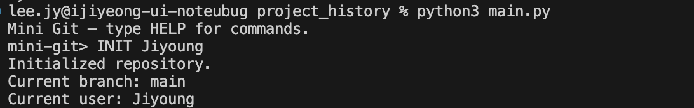

**연결되는 코드 — `main()`과 `MiniGit.execute()`**

```python
# main(): 입력을 저장소 객체에 전달
line = input('mini-git> ')
output = repo.execute(line)

# execute(): 따옴표를 고려해 명령과 인자 분리
parts = shlex.split(line)
command, *args = parts
command = command.upper()

# INIT 분기의 상태 설정
self.user = args[0]
self.branches['main'] = None
```

`INIT Jiyoung`을 분리하면 `command`는 INIT, `args`는 `['Jiyoung']`입니다. `self`는 실행 중인 저장소 객체이고, `args[0]`은 첫 번째 인자입니다. 객체 생성 시 현재 브랜치 이름은 main으로 설정됩니다. INIT은 사용자와 빈 HEAD를 저장한 뒤 성공 문구를 반환합니다. 재초기화와 인자 검사는 발췌에서 생략했습니다.

#### 2) 첫 번째 커밋과 로그

`COMMIT "첫 번째 커밋"`으로 부모 없는 루트 커밋을 생성했습니다. LOG에서 작성자, UTC 시간, 메시지와 main 브랜치 위치를 확인할 수 있습니다. 캡처의 LOG 앞 한글 입력 흔적은 명령어의 일부가 아닙니다.

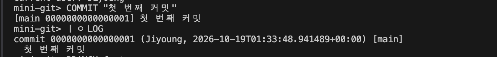

**연결되는 코드 — COMMIT 분기**

```python
self.counter += 1
h = f'{self.counter:016x}'
head = self.branches[self.branch]
parents = (head,) if head is not None else ()
c = Commit(h, args[0], self.user, datetime.now(timezone.utc), parents)
self.commits[h] = c
```

`+= 1`은 카운터를 하나 늘립니다. `016x`는 정수를 최소 16자리의 16진수로 바꾸고 앞을 0으로 채웁니다. 첫 해시는 `0000000000000001`입니다. HEAD가 None이므로 부모는 빈 튜플 `()`이고, `(head,)`는 부모가 있을 때 만드는 원소 한 개짜리 튜플입니다. 메시지·작성자·UTC 시간을 커밋으로 묶어 해시를 키로 저장합니다. 이후 HEAD와 인덱스도 갱신하므로 LOG에서 첫 커밋과 `[main]`이 표시됩니다.

#### 3) feature 브랜치 생성과 전환

`BRANCH feature`는 현재 첫 번째 커밋을 가리키는 브랜치를 생성합니다. 이어서 `SWITCH feature`를 실행해 작업 브랜치를 변경했습니다.

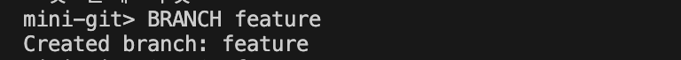

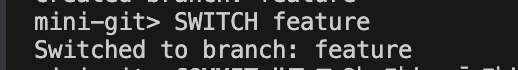

**연결되는 코드 — BRANCH와 SWITCH 분기**

```python
# BRANCH feature
self.branches[args[0]] = self.branches[self.branch]

# SWITCH feature
self.branch = args[0]
```

첫 줄은 현재 main의 HEAD 해시를 새 키 feature의 값으로 복사합니다. 커밋 자체를 복제하지는 않습니다. 두 번째 줄은 현재 선택한 브랜치 이름을 feature로 변경합니다. 따라서 BRANCH만 실행하면 여전히 main이고, SWITCH까지 실행해야 이후 커밋이 feature에 연결됩니다.

#### 4) 브랜치별 커밋 생성

feature에서 로그인 커밋을 생성한 뒤 main으로 전환해 메인 커밋을 생성했습니다. 두 커밋은 첫 번째 커밋을 공통 부모로 가집니다.

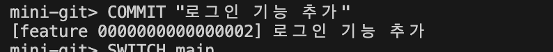

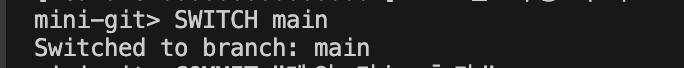

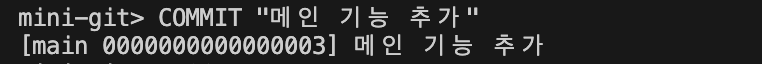

**연결되는 코드 — 부모 연결과 현재 브랜치 HEAD 갱신**

```python
self.adjacency[h] = set(parents)
for parent in parents:
    self.adjacency[parent].add(h)
self.branches[self.branch] = h
self.index.add(c)
```

`set(parents)`는 새 커밋에서 부모로 가는 연결을 만들고, `add(h)`는 부모에서 새 자식으로 가는 연결을 추가합니다. 이 양방향 인접 정보는 PATH에 사용합니다. 커밋의 `parents` 자체는 부모 방향만 유지합니다.

현재 브랜치의 HEAD만 새 해시로 갱신합니다. 로그인 커밋 후에는 feature가 2번, main이 1번을 가리킵니다. main으로 돌아와 메인 커밋을 만들면 main이 3번으로 이동하며, 두 새 커밋 모두 1번을 부모로 갖습니다. 마지막 `index.add(c)`는 이 커밋을 검색할 수 있도록 역색인을 갱신합니다.

#### 5) 전체 로그와 브랜치 위치

`LOG`에서 부모인 첫 번째 커밋이 두 자식보다 먼저 출력됩니다. feature는 두 번째 커밋, main은 세 번째 커밋을 가리킵니다.

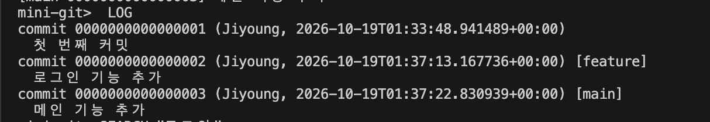

**연결되는 코드 — `topological_order()`의 Kahn 알고리즘**

```python
degrees = {h: len(c.parents) for h, c in commits.items()}
queue = deque(h for h in commits if degrees[h] == 0)
result = []
while queue:
    h = queue.popleft()
    result.append(h)
    for child in children[h]:
        degrees[child] -= 1
        if degrees[child] == 0:
            queue.append(child)
```

위 코드는 자식 목록 `children`을 구성하는 부분을 생략한 발췌입니다. `degrees`는 아직 처리하지 않은 부모의 수입니다. 부모가 없는 커밋부터 큐에 넣고, `popleft()`로 먼저 들어온 것을 먼저 처리합니다. 부모를 처리할 때 자식의 남은 부모 수를 줄이고 0이 되면 큐에 넣습니다.

예시에서는 처음에 1번만 준비되고, 1번을 출력한 뒤 2번과 3번이 준비됩니다. 반환된 해시 목록을 `format_commits()`가 작성자·시간·메시지로 바꿔 출력하므로 부모가 자식보다 먼저 보입니다. 시간은 O(V+E)입니다.

#### 6) 키워드 및 작성자 검색

`SEARCH "로그인"`은 로그인 토큰을 포함한 커밋 1개를 반환합니다. `SEARCH --author=Jiyoung`은 작성자가 일치하는 커밋 3개를 반환합니다. 작성자 검색 캡처 아래에는 이어서 실행한 날짜 정렬도 포함되어 있습니다.

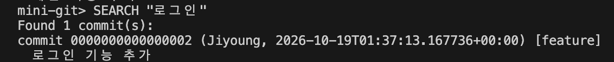

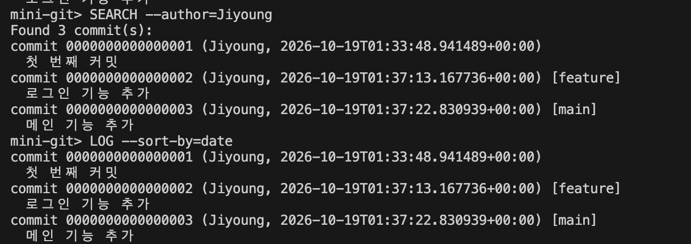

**연결되는 코드 — `InvertedIndex.add()`와 `search()`**

```python
# 커밋 시 검색 목록 준비
for token in dict.fromkeys(commit.message.lower().split()):
    self.keywords.setdefault(token, []).append(commit.hash)
self.authors.setdefault(commit.author, []).append(commit.hash)

# 작성자 검색 분기
if author:
    return list(self.authors.get(query, []))
```

`lower().split()`은 메시지를 소문자로 바꾸고 공백으로 나눕니다. `dict.fromkeys()`는 같은 토큰을 중복 등록하지 않게 합니다. `setdefault(token, [])`는 키가 없으면 빈 목록을 준비하고, `append()`가 커밋 해시를 추가합니다. `get(query, [])`는 해당 키가 없으면 빈 목록을 반환합니다.

예시에서 로그인 토큰의 게시 목록에는 2번만 있고, 작성자 Jiyoung 목록에는 1·2·3번이 있습니다. 키워드 검색은 토큰별 목록을 가져와 교집합을 구하고, 작성자 검색은 해당 작성자의 목록을 복사합니다. 전체 커밋 메시지를 순회하지 않습니다. 단일 토큰·작성자 조회는 평균 O(1)에 목록을 찾고 결과 k개를 복사하는 O(k)가 필요합니다. 해시는 실제로 전체 문자열을 저장하며 여기서는 끝자리로 설명했습니다.

#### 7) 날짜와 작성자 기준 정렬

`LOG --sort-by=date`는 생성 시간 오름차순으로 출력합니다. `LOG --sort-by=author`에서는 작성자가 모두 같아 안정 정렬에 따라 생성 순서를 유지합니다.

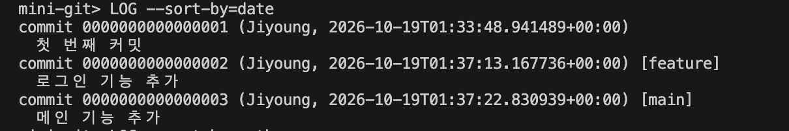

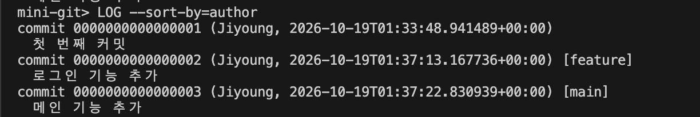

**연결되는 코드 — LOG의 옵션 분기와 `merge_sort()`**

```python
field = 'timestamp' if args[0].endswith('date') else 'author'
ordered = merge_sort(list(self.commits.values()), key=lambda c: getattr(c, field))

# merge_sort 내부의 병합 판단
if key(left[i]) <= key(right[j]):
    merged.append(left[i])
    i += 1
else:
    merged.append(right[j])
    j += 1
```

옵션에 따라 `field`가 timestamp 또는 author가 됩니다. `lambda`는 짧은 함수를 만드는 문법이고, `getattr(c, field)`는 지정된 이름의 커밋 속성을 읽습니다. 이 비교 키를 정렬 함수에 전달하므로 알고리즘 하나로 두 정렬을 지원합니다.

병합 정렬은 정렬된 두 묶음에서 앞 원소를 비교해 작은 것을 결과에 넣습니다. `<=`로 동률이면 왼쪽을 먼저 선택하므로 원래 순서가 유지됩니다. 작성자가 모두 같아도 1·2·3번 순서가 유지되는 이유입니다. 키 계산과 비교를 상수로 보면 시간 O(n log n), 보조 공간 O(n)입니다. 옵션 LOG는 지정한 정렬 기준을 우선하며 기본 LOG의 위상 순서와 구분됩니다.

#### 8) 조상 탐색과 최단 경로

`ANCESTORS 0000000000000003`은 세 번째 커밋의 조상인 첫 번째 커밋만 출력합니다. `PATH 0000000000000002 0000000000000003`은 두 번째 → 첫 번째 → 세 번째 경로를 출력합니다.

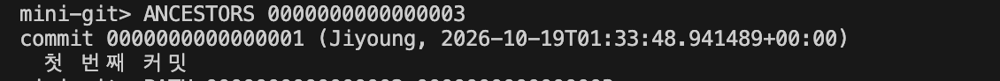

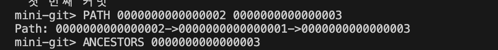

**연결되는 코드 — `ancestors()`의 DFS**

```python
visited = set()
stack = list(commits[start].parents)
result = []
while stack:
    h = stack.pop()
    if h not in visited:
        visited.add(h)
        result.append(h)
        stack.extend(commits[h].parents)
```

시작 커밋 자체가 아니라 그 부모를 스택에 넣습니다. `pop()`은 마지막에 넣은 항목을 꺼내고, `extend()`는 찾은 커밋의 부모들을 스택에 추가합니다. `visited`는 공통 조상을 중복 출력하지 않게 합니다. 3번의 부모는 1번이고 1번에는 부모가 없어 결과는 1번 하나입니다. 형제 위치인 2번은 포함되지 않습니다. 도달 가능한 그래프에서 O(V+E)입니다.

**연결되는 코드 — `shortest_path()`의 BFS**

```python
queue = deque([start])
previous = {start: None}
# while 반복문 안에서 현재 노드를 꺼낸 뒤 이웃 검사
for neighbor in merge_sort(list(adjacency[current]), key=lambda h: h):
    if neighbor not in previous:
        previous[neighbor] = current
        queue.append(neighbor)
```

위 코드는 BFS의 초기화와 이웃 등록 부분입니다. 큐에서 가까운 순서대로 꺼내 탐색하므로 간선 수가 최소인 경로를 얻습니다. `previous`는 방문 여부와 직전 노드를 저장합니다. 이웃을 직접 구현한 병합 정렬로 정렬해 동률 경로의 사전순 규칙을 적용합니다.

이 예시의 방문 흐름은 2번 → 1번 → 3번입니다. 도착 후 `previous`를 따라 역순으로 경로를 모으고 `path[::-1]`로 뒤집어 출력합니다. BFS 자체는 O(V+E)이며 현재 구현에는 이웃 정렬 비용이 추가됩니다. DFS는 부모만 따라 조상을 찾고, BFS는 양방향 인접 정보를 따라 두 점 사이 최단 경로를 찾는다는 차이가 있습니다.

<details>
<summary>같은 명령을 다시 실행한 확인 화면 2개</summary>

같은 상태에서 ANCESTORS와 PATH를 반복 실행한 화면입니다. 각각 동일한 조상과 경로가 출력되었습니다.

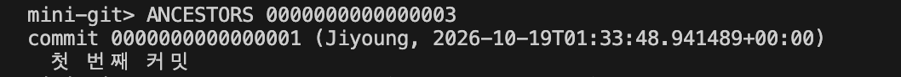

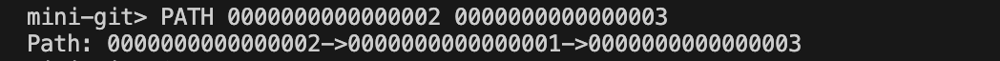

</details>

#### 9) 프로그램 종료

`QUIT`을 실행하면 `Bye!`를 출력하고 REPL이 종료됩니다. 이 시점에 메모리의 커밋 기록은 사라집니다.

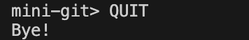

**연결되는 코드 — `execute()`의 종료 신호와 `main()`의 반복 종료**

```python
# execute(): EXIT 또는 QUIT이면 종료 문구 반환
if command in ('EXIT', 'QUIT'):
    if args:
        raise ValueError('Invalid args')
    return 'Bye!'

# main(): 결과 출력 후 반복문 종료
if output == 'Bye!':
    break
```

`return`은 명령 처리 함수의 실행을 끝내고 결과를 전달합니다. `break`는 main의 입력 반복문을 끝냅니다. 따라서 화면에 Bye!가 출력되고 일반 터미널로 돌아옵니다. HELP는 종료하지 않고 명령 형식을 안내합니다. 인자 오류와 존재하지 않는 브랜치·커밋은 검사 후 메시지로 반환해 REPL을 계속 유지합니다.

### 텍스트 실행 기록

아래는 사용자가 실행한 결과를 바탕으로 정리한 기록입니다. 명령 앞에 섞인 한글 오타와 중복 실행한 ANCESTORS/PATH는 정리했습니다. 시간은 당시 출력이며, 새로 실행하면 현재 UTC 시간으로 달라집니다. 사용자명과 터미널의 계정·장치 이름도 실행 환경에 따라 달라집니다.

```text
lee.jy@ijiyeong-ui-noteubug project_history % python3 main.py
Mini Git — type HELP for commands.
mini-git> INIT Jiyoung
Initialized repository.
Current branch: main
Current user: Jiyoung
mini-git> COMMIT "첫 번째 커밋"
[main 0000000000000001] 첫 번째 커밋
mini-git> LOG
commit 0000000000000001 (Jiyoung, 2026-10-19T01:33:48.941489+00:00) [main]
  첫 번째 커밋
mini-git> BRANCH feature
Created branch: feature
mini-git> SWITCH feature
Switched to branch: feature
mini-git> COMMIT "로그인 기능 추가"
[feature 0000000000000002] 로그인 기능 추가
mini-git> SWITCH main
Switched to branch: main
mini-git> COMMIT "메인 기능 추가"
[main 0000000000000003] 메인 기능 추가
mini-git> LOG
commit 0000000000000001 (Jiyoung, 2026-10-19T01:33:48.941489+00:00)
  첫 번째 커밋
commit 0000000000000002 (Jiyoung, 2026-10-19T01:37:13.167736+00:00) [feature]
  로그인 기능 추가
commit 0000000000000003 (Jiyoung, 2026-10-19T01:37:22.830939+00:00) [main]
  메인 기능 추가
mini-git> SEARCH "로그인"
Found 1 commit(s):
commit 0000000000000002 (Jiyoung, 2026-10-19T01:37:13.167736+00:00) [feature]
  로그인 기능 추가
mini-git> SEARCH --author=Jiyoung
Found 3 commit(s):
commit 0000000000000001 (Jiyoung, 2026-10-19T01:33:48.941489+00:00)
  첫 번째 커밋
commit 0000000000000002 (Jiyoung, 2026-10-19T01:37:13.167736+00:00) [feature]
  로그인 기능 추가
commit 0000000000000003 (Jiyoung, 2026-10-19T01:37:22.830939+00:00) [main]
  메인 기능 추가
mini-git> LOG --sort-by=date
commit 0000000000000001 (Jiyoung, 2026-10-19T01:33:48.941489+00:00)
  첫 번째 커밋
commit 0000000000000002 (Jiyoung, 2026-10-19T01:37:13.167736+00:00) [feature]
  로그인 기능 추가
commit 0000000000000003 (Jiyoung, 2026-10-19T01:37:22.830939+00:00) [main]
  메인 기능 추가
mini-git> LOG --sort-by=author
commit 0000000000000001 (Jiyoung, 2026-10-19T01:33:48.941489+00:00)
  첫 번째 커밋
commit 0000000000000002 (Jiyoung, 2026-10-19T01:37:13.167736+00:00) [feature]
  로그인 기능 추가
commit 0000000000000003 (Jiyoung, 2026-10-19T01:37:22.830939+00:00) [main]
  메인 기능 추가
mini-git> ANCESTORS 0000000000000003
commit 0000000000000001 (Jiyoung, 2026-10-19T01:33:48.941489+00:00)
  첫 번째 커밋
mini-git> PATH 0000000000000002 0000000000000003
Path: 0000000000000002->0000000000000001->0000000000000003
mini-git> QUIT
Bye!
lee.jy@ijiyeong-ui-noteubug project_history %
```

### 결과 해석

| 확인 항목      | 실행 결과와 의미                                     |
| -------------- | ---------------------------------------------------- |
| 초기화         | main 브랜치와 작성자 Jiyoung이 설정됨                |
| 브랜치 분기    | feature는 두 번째 커밋, main은 세 번째 커밋을 가리킴 |
| 부모 우선 로그 | 첫 번째 커밋이 두 자식 커밋보다 먼저 출력됨          |
| 키워드 검색    | `로그인` 토큰이 포함된 두 번째 커밋만 검색됨         |
| 작성자 검색    | Jiyoung이 작성한 커밋 3개가 검색됨                   |
| 날짜 정렬      | 첫 번째 → 두 번째 → 세 번째 순서로 출력됨            |
| 작성자 정렬    | 모두 같은 작성자이므로 생성 순서가 유지됨            |
| 조상 탐색      | 세 번째 커밋의 조상인 첫 번째 커밋만 출력됨          |
| 최단 경로      | 두 번째 → 첫 번째 → 세 번째, 총 2개 간선             |
| 종료           | `Bye!` 출력 후 일반 터미널로 복귀                    |

커밋 옆의 `[main]`, `[feature]`는 해당 커밋을 현재 가리키는 브랜치입니다. 첫 커밋 옆의 `[main]` 표시는 main에 새 커밋을 만들면 새 커밋으로 이동합니다. 커밋 자체의 작성자나 메시지가 바뀌는 것은 아닙니다.

해시는 첫 커밋부터 증가하는 16자리 이상의 16진수이며, 한 세션에서 중복되지 않습니다. `+00:00`은 UTC를 의미하며 한국 시간은 여기에 9시간을 더한 값입니다.

## 11. 확인된 내용과 검증 방법

### 자동 테스트

```sh
python3 -m unittest discover -s tests -v
```

표준 라이브러리 unittest 기반 테스트 6개를 실행하여 통과했습니다.

| 테스트                                           | 확인 내용                                                  |
| ------------------------------------------------ | ---------------------------------------------------------- |
| test_branch_graph_and_search                     | 초기화, 브랜치 분기, HEAD, 키워드·작성자 검색, 정렬 명령   |
| test_disconnected_roots                          | 서로 연결되지 않은 커밋의 No path, 자기 자신 경로, 빈 조상 |
| test_error_handling                              | 잘못된 인자·따옴표, 없는 브랜치·커밋, 종료                 |
| test_sort_stability_and_author_index             | 병합 정렬 안정성, 빈 입력, 반복 토큰 제거, 작성자 인덱스   |
| test_lexical_shortest_path_and_diamond_ancestors | 최단 경로 사전순 동률 처리, 공통 조상 중복 제거, 위상 순서 |
| test_unique_hashes                               | 커밋 1,000개 해시 유일성과 깊은 이력의 조상 탐색           |

다중 부모 그래프는 탐색 알고리즘 검증용으로만 구성하며 Merge 명령은 제공하지 않습니다.

### 사용자 실행으로 확인한 내용

- INIT으로 Jiyoung 사용자를 설정하고 main에서 첫 번째 커밋을 생성했습니다.
- feature에서 로그인 커밋, main에서 메인 커밋을 각각 생성했습니다.
- LOG에서 부모가 자식보다 먼저 출력되는 것을 확인했습니다.
- 로그인 검색 1개, 작성자 검색 3개, 날짜·작성자 정렬 결과를 확인했습니다.
- 세 번째 커밋의 조상과 두 번째에서 세 번째까지의 최단 경로를 확인했습니다.
- QUIT 실행 후 일반 터미널로 돌아오는 것을 확인했습니다.

직접 실행한 예시는 커밋 3개와 작성자 1명의 시나리오입니다. 서로 다른 작성자 이름에 따른 정렬 비교를 이 실행 기록으로 입증하는 것은 아니며, 정렬 알고리즘의 안정성은 자동 테스트에서 별도로 확인합니다.

## 12. 자주 만나는 상황과 해결 방법

| 화면 또는 상황                              | 이유와 해결 방법                                                                                             |
| ------------------------------------------- | ------------------------------------------------------------------------------------------------------------ |
| `mini-git>`만 표시됨                        | 정상입니다. 명령 입력을 기다리는 중입니다.                                                                   |
| `Repository not initialized`                | 먼저 `INIT Jiyoung`을 실행하세요.                                                                            |
| `Invalid args`                              | 인자 개수, 따옴표, 옵션을 확인하세요. 공백이 있는 메시지는 따옴표로 감쌉니다. REPL은 실제 입력도 표시합니다. |
| `Unknown command: PWD`                      | Mini Git 안에서 터미널 명령을 입력한 상태입니다. `QUIT` 후 `pwd`를 사용하세요.                               |
| 다시 켰더니 기록이 없음                     | 메모리 기반 프로그램이므로 정상입니다. INIT부터 다시 실행하세요.                                             |
| `LOG --sort-by=author` 결과가 날짜순과 같음 | 작성자가 모두 같으면 안정 정렬에 의해 생성 순서가 유지됩니다.                                                |
| `No path`                                   | 두 커밋이 서로 연결되지 않은 별도의 루트에서 시작한 경우입니다.                                              |

## 13. 사용 기술과 파일 구조

Python 표준 라이브러리와 기본 자료형만 사용합니다. dict는 커밋·브랜치·인덱스, set은 인접 관계·방문 확인, deque는 BFS·위상 정렬의 큐, list는 DFS 스택·정렬에 사용합니다.

```text
project_history/
├── main.py
├── README.md
├── .gitignore
├── tests/
│   └── test_main.py
└── docs/
    └── images/
        └── commit-graph.svg
```

## 14. 구현 범위와 제출 안내

필수 제출 파일은 main.py와 README.md입니다. 테스트를 재현할 수 있도록 tests/를, README 그림이 표시되도록 docs/images/도 함께 저장소에 포함합니다.

이 프로젝트의 COMMIT은 커밋 메타데이터를 메모리에 생성합니다. 실제 Git 커밋이나 파일 백업을 만들지 않습니다. GitHub에 업로드할 때는 QUIT으로 종료한 뒤 일반 터미널에서 실제 Git 명령을 실행합니다.

실행 결과 그림은 구조를 설명하는 SVG입니다. 실제 터미널 캡처 17개는 10절에 실행 순서대로 수록했습니다. 종료하면 기록이 사라지므로 추가 캡처가 필요한 경우 QUIT 전에 저장하면 됩니다.

## 15. 경계 상황과 알고리즘 인터페이스

### 초기 HEAD와 빈 브랜치

INIT 직후 현재 브랜치 이름인 `self.branch`는 `main`, 실제 HEAD 값인 `self.branches['main']`은 `None`입니다. 아직 커밋이 없다는 뜻입니다. INIT을 다시 실행하면 `Repository already initialized`를 반환하며 기존 기록을 유지합니다.

```text
mini-git> INIT Jiyoung
Initialized repository.
Current branch: main
Current user: Jiyoung
mini-git> LOG
No commits
mini-git> BRANCH empty
Created branch: empty
```

마지막 명령은 커밋 생성 전이므로 `branches['empty'] = None`을 복사합니다. BRANCH는 새 커밋을 생성하지 않고 현재 위치를 복사하므로 빈 HEAD도 그대로 복사하는 것이 맞습니다. HEAD 값 자체를 출력하는 기능은 없으며 위 설명은 내부 상태를 나타냅니다.

| 상태                  | 책임                              |
| --------------------- | --------------------------------- |
| `self.branch`         | 현재 선택한 브랜치 이름           |
| `self.branches[name]` | 해당 브랜치의 HEAD 해시 또는 None |
| `self.commits[hash]`  | 해시에 해당하는 불변 커밋 데이터  |

빈 상태에서 main과 empty를 만든 뒤 각 브랜치에 첫 커밋을 만들면 부모 없는 루트가 두 개 생깁니다. LOG는 둘 다 출력하며, 둘 사이 PATH는 `No path`입니다. 예를 들어 새 세션에서 INIT → BRANCH empty → COMMIT first → SWITCH empty → COMMIT second를 실행하면 다음과 같습니다(시간은 생략한 설명용 출력).

```text
LOG: 0000000000000001 (first), 0000000000000002 (second)
PATH 0000000000000001 0000000000000002: No path
```

### 순서 보장의 의미

Kahn 알고리즘은 진입 차수가 0인 노드만 FIFO 큐에 넣어 부모가 처리된 뒤 자식을 처리합니다. 같은 단계에서는 사전 삽입 순서와 큐 등록 순서를 따르므로 같은 상태에서 결정적인 결과를 얻지만, 전체 생성 순서나 날짜순을 보장하지는 않습니다. 여기서 큐의 순서 결정과 병합 정렬의 동률 안정성은 서로 다른 성질입니다.

ANCESTORS의 DFS 순서는 탐색 과정에서 발견된 순서입니다. 최신순·거리순·부모 우선 순서를 의미하지 않습니다. 여러 부모가 있으면 스택에 마지막으로 넣은 부모를 먼저 방문합니다. 공통 조상은 한 번만 출력합니다.

PATH는 사전순으로 정렬한 이웃을 BFS 큐에 넣습니다. 같은 깊이의 경로를 사전순으로 확장하고 처음 발견한 노드의 선행 노드를 유지하여 같은 최소 거리 중 경로 문자열이 가장 작은 결과를 선택합니다. 이는 여러 정답 중 결과를 일관되게 선택하기 위한 규칙입니다.

### 검색 규칙 예시

```text
COMMIT "Login, 기능 추가"
SEARCH login
# 0개: 구두점이 유지되어 login과 login,은 다른 토큰
SEARCH "LOGIN,"
# 1개: 키워드는 소문자로 정규화
SEARCH "기능 추가"
# 1개: 기능과 추가가 모두 포함되어야 하는 AND 검색
SEARCH --author=Jiyoung
# INIT Jiyoung으로 시작했다면 해당 작성자의 커밋 검색
```

위 코드 블록의 `#` 줄은 설명이며 CLI에 입력하지 않습니다. 작성자 인덱스는 대소문자를 구분하므로 Jiyoung과 jiyoung은 다릅니다.

### 탐색 함수의 입출력 계약

| 함수              | 입력                                  | 반환값·오류                                              |
| ----------------- | ------------------------------------- | -------------------------------------------------------- |
| topological_order | `dict[str, Commit]`                   | 부모 우선 해시 리스트, 빈 입력은 [], 사이클은 ValueError |
| shortest_path     | `dict[str, set[str]]`, 시작·도착 해시 | 경로 리스트, 경로 없음은 []                              |
| ancestors         | 커밋 사전, 시작 해시                  | 자신을 제외한 조상 해시 리스트, 조상 없음은 []           |
| merge_sort        | 원소 리스트, 비교 키 함수             | 원본을 변경하지 않는 정렬 리스트, 빈 입력은 []           |

그래프 함수에는 모든 참조 노드가 존재하는 유효한 구조를 전달해야 합니다. CLI에서는 존재하지 않는 입력 해시를 먼저 검사하여 `Unknown commit: <hash>`로 안내합니다. 직접 함수를 호출하는 경우 누락된 노드에서 KeyError가 발생할 수 있습니다.

사이클 때문에 LOG가 `Invalid commit graph`를 반환하면 직접 수정한 테스트 데이터의 parents 관계를 점검하세요. 정상 CLI에서는 기존 커밋의 부모를 변경할 수 없어 사이클이 생성되지 않습니다. 오류가 난 경우 REPL은 계속 실행되며, 현재 버전에는 손상된 그래프를 복구하는 명령이 없습니다.

### 해시 재현성과 정렬 비용

카운터는 세션마다 0에서 시작하므로 같은 커밋 생성 순서에서는 같은 해시가 재현됩니다. 테스트·CI에서 난수 시드는 필요하지 않습니다. 각 테스트가 새 MiniGit 객체로 시작하면 다른 테스트의 카운터에 영향을 받지 않습니다. 다만 메시지 내용과 해시가 연결되지 않으므로 생성 순서가 바뀌면 같은 메시지의 해시도 바뀝니다. 서로 다른 세션에서 같은 해시가 반복될 수 있어 세션 간 전역 유일성은 보장하지 않습니다.

테스트에서 timestamp까지 재현하려면 향후 시계 함수를 주입해 고정 시간을 사용하도록 개선할 수 있습니다. 분산 환경에서는 저장소 ID·노드 ID·카운터 조합이나 내용 기반 해시를 검토해야 합니다. 난수 ID를 선택할 경우 고정 시드는 테스트 재현을 위한 방법이며 전역 충돌 방지 보장은 별도로 필요합니다.

병합 정렬의 O(n log n)은 키 계산과 비교가 O(1)이라는 가정입니다. 현재 구현은 비교할 때마다 key를 호출하므로 키 비용이 K, 비교 비용이 C이면 대략 O(n log n × (K+C))입니다. 작성자 문자열 비교는 공통 접두사 길이에 따라 비용이 늘 수 있습니다. 키를 미리 계산하여 원소와 함께 저장하면 키 계산 횟수를 O(n)으로 줄일 수 있습니다.

## 16. 대규모 데이터의 병목 예측과 확장성 설계

이 절은 현재 메모리 구현을 분석한 **향후 설계안**입니다. 샤딩·외부 저장소·캐시·네트워크는 구현하지 않았으며 보너스 기능을 추가하는 내용도 아닙니다. N은 커밋 수, E는 부모 연결 수, P는 중복을 제거한 메시지 토큰들의 전체 게시 항목 수입니다. 아래 규모는 예상 병목을 설명하기 위한 가정이며 실측 성능 수치가 아닙니다.

### 병목 후보와 자료구조 개선

| 작업·자료구조  | 규모가 커질 때 예상되는 병목                                                         | 개선 방향과 비용                                                                                            |
| -------------- | ------------------------------------------------------------------------------------ | ----------------------------------------------------------------------------------------------------------- |
| 커밋·인접 사전 | 모든 메시지·노드·양방향 간선을 RAM에 보관. 객체·문자열·집합의 부가 비용도 누적       | 커밋 정수 ID, 압축 인접 배열, 디스크 저장과 필요한 노드만 읽기. 저장 형식 변환과 조회 비용이 추가됨         |
| 단일 역색인    | 흔한 토큰이나 작성자의 게시 목록 길이가 N에 근접. 인덱스도 한 프로세스 메모리에 집중 | 정수 ID 게시 목록, 차분 압축, 청크 저장. 해제·교집합 계산의 CPU 비용과 쓰기 설계가 필요                     |
| 다중 토큰 검색 | 조회마다 긴 목록을 set으로 복사하여 시간과 임시 메모리가 게시 목록 길이 합에 비례    | 정렬된 게시 목록의 포인터 교집합, 희소 목록 우선, 문서 빈도 통계. 큰 목록은 건너뛰기 정보를 추가            |
| LOG            | 매번 O(N+E) 그래프 구성·순회, 결과 문자열도 한꺼번에 생성                            | 자식 목록·차수 등 유지, 저장소 버전별 순서 캐시, 페이지 또는 스트리밍 출력. 커밋 시 갱신·무효화 비용이 증가 |
| 정렬 LOG       | 전체 O(N log N) 정렬과 O(N) 보조 메모리                                              | 날짜·작성자 정렬 인덱스 유지, 외부 병합 정렬, 키 사전 계산. 저장 공간과 삽입 비용이 증가                    |
| PATH·ANCESTORS | 긴 이력의 O(N+E) 탐색과 방문 집합, PATH의 반복 이웃 정렬                             | 정렬 이웃 캐시, 연결 요소 정보로 불가능한 PATH 조기 판정, 반복 쿼리 캐시. 갱신 때 캐시 일관성 관리 필요     |
| 출력           | 검색이 빨라도 수십만 커밋을 터미널에 출력하면 대기·문자열 메모리가 커짐              | 결과 제한·페이지네이션·이터레이터 기반 출력. 전체 결과가 필요하면 순차 읽기 제공                            |

예를 들어 N=100만, 커밋마다 서로 다른 토큰이 평균 10개라면 키워드 게시 항목 P는 약 1,000만입니다. 작성자 인덱스에도 약 N개 항목이 필요합니다. 개념적 저장량은 메시지 바이트 수를 제외하면 O(N+E+P)이지만 Python 객체 오버헤드가 있어 항목 수만으로 실제 RAM 사용량을 확정할 수 없습니다. 흔한 토큰은 역색인이 있어도 결과가 N개이므로 조회·출력이 O(N)에 가까워집니다.

dict와 set 조회는 평균 O(1)이며, 해시 충돌이 극심하면 단일 조회의 최악 비용은 원소 수에 비례할 수 있습니다. 따라서 평균 조회 비용만으로 대규모 검색 성능을 보장할 수 없습니다.

### 인덱스 분산과 외부 인덱스 설계

```text
커밋 생성
  → 커밋 원본 저장소 + 재처리 가능한 인덱스 갱신 기록
  → 키워드 / 작성자별 인덱스 작업
  → 안정적인 파티션 해시로 샤드 선택
  → 해당 샤드의 게시 목록 갱신

검색 요청
  → 같은 파티션 규칙으로 관련 샤드 조회
  → 게시 목록 교집합 또는 분할 목록 병합
  → 커밋 원본 일괄 조회
  → 순서 보장 후 페이지 단위 출력
```

1. **단계적 외부 저장:** 먼저 단일 머신의 디스크 기반 커밋·게시 목록 저장소로 메모리 한계를 줄입니다. 원본 커밋과 인덱스를 분리하여 인덱스를 원본에서 재구축할 수 있게 합니다. 외부 검색 인덱스는 향후 대안이며 현재 의존성에는 포함하지 않습니다.
2. **키 기반 샤딩:** 키워드와 작성자 이름에 안정적인 해시를 적용해 `partition_hash(key) % shard_count`로 담당 샤드를 정합니다. Python 내장 문자열 hash는 프로세스 사이에 달라질 수 있어 분산 파티션 규칙으로 그대로 사용하지 않습니다. 여러 단어의 AND 검색은 해당 단어를 가진 샤드들의 목록을 받아 교집합을 구합니다.
3. **쏠림 대응:** 키워드로만 나누면 흔한 단어 하나가 특정 샤드에 집중됩니다. 큰 게시 목록은 커밋 ID 범위로 추가 분할하고 조회 시 여러 조각을 합칩니다. 이때 조회 요청 수와 병합 비용이 증가합니다. 작성자 한 명에게 커밋이 몰릴 때도 같은 대책이 필요합니다.
4. **일관성과 재처리:** 현재 단일 프로세스에서는 COMMIT 반환 전에 인덱스를 갱신합니다. 분산 설계에서는 원본 저장과 갱신 기록을 함께 확정한 뒤 작업자가 `(index_type, key, commit_id)` 단위로 멱등 처리하도록 설계합니다. 즉시 검색을 보장하려면 필요한 샤드의 반영 완료를 기다리고, 지연 반영을 허용한다면 검색에 보이지 않는 시간과 인덱스 버전을 명시해야 합니다.
5. **샤드 수 변경:** 단순 나머지 연산의 분모가 바뀌면 많은 키가 이동합니다. 파티션 매핑 버전과 재색인 절차를 두고, 새 인덱스 구축 중에는 기존 버전으로 조회한 뒤 완료 시 전환합니다. 전환 중 쓰기는 갱신 기록으로 재생하고 중복은 커밋 ID로 제거합니다.
6. **그래프 저장과의 관계:** 역색인 분산만으로 PATH가 빨라지지는 않습니다. 커밋 ID로 그래프를 분산하면 경계를 넘는 BFS에 네트워크 왕복이 늘어납니다. 초기 단계에서는 저장소별 그래프를 한 곳에 유지하고 검색 인덱스만 분리하는 방식을 우선 검토합니다.

### 확장 전 측정할 항목

현재 1,000개 커밋 테스트는 정확성 확인이며 성능 벤치마크가 아닙니다. 확장 검증에서는 1만·10만·100만 커밋처럼 규모를 단계적으로 늘리고 긴 체인, 넓은 분기, 흔한 단어 집중, 작성자 집중을 각각 구성합니다. 적재 시간, 최고 메모리, 인덱스 크기, 검색·LOG·PATH 지연, 결과 출력 시간을 구분해 측정해야 합니다.

최적화나 분산 후에도 원본 순회 결과와 검색 결과의 일치, 커밋 ID 유일성, 부모 우선 LOG, PATH의 최단 거리와 사전순 동률 규칙을 검증합니다. 외부 저장 도입 시에는 재시작·갱신 재처리·부분 실패 후 누락과 중복이 없는지도 확인해야 합니다. 실제 병목을 측정한 뒤 메모리 압축 → 외부 저장 → 인덱스 분산 순으로 필요한 개선을 선택합니다.

## 17. 구현 근거와 요구사항 변경에 따른 설계

명령어의 동작을 확인하고 자료구조와 알고리즘을 선택한 이유를 정리했습니다. 이어서 데이터 규모나 요구사항이 달라졌을 때의 설계 방향을 설명합니다. 변경 시나리오는 현재 구현과 구분한 개선안이며, 선택 보너스는 기존 구현 범위에서 제외합니다.

### 명령어별 동작과 검증 근거

| 확인할 동작                                           | 현재 동작과 확인 근거                                                                                                                                              |
| --------------------------------------------------- | ------------------------------------------------------------------------------------------------------------------------------------------------------------------ |
| INIT 후 main·HEAD·사용자가 초기화되는가?            | `INIT Jiyoung` 후 `self.branch == 'main'`, `branches['main'] is None`, `user == 'Jiyoung'`. 첫 COMMIT이 생기면 HEAD가 그 해시로 이동합니다.                        |
| BRANCH·SWITCH 후 해당 브랜치에 COMMIT이 반영되는가? | BRANCH는 현재 HEAD를 복사하고 SWITCH는 현재 브랜치를 선택합니다. COMMIT은 선택한 브랜치의 HEAD만 갱신합니다. 10절의 feature·main 실행 화면에서 확인할 수 있습니다. |
| LOG에서 부모가 자식보다 먼저 출력되는가?            | `topological_order()`가 진입 차수 기반 Kahn 알고리즘을 사용합니다. 자동 테스트는 각 부모의 위치가 자식보다 앞인지 검사합니다.                                      |
| PATH가 최단 경로 또는 No path를 출력하는가?         | `shortest_path()`의 BFS로 무방향 최단 경로를 찾습니다. 2→1→3 시연과 연결되지 않은 두 루트의 자동 테스트가 있습니다.                                                |
| ANCESTORS가 모든 조상을 출력하는가?                 | 반복형 DFS로 부모를 따라가고 방문 집합으로 중복을 제거합니다. 공통 조상과 1,000개 커밋 이력을 테스트합니다.                                                        |
| SEARCH와 정렬 옵션이 동작하는가?                    | 키워드·작성자 인덱스로 검색하고 직접 구현한 병합 정렬로 날짜·작성자 오름차순을 지원합니다. 시연과 자동 테스트의 범위는 11절에 기록했습니다.                        |

짧게 설명하면: “명령을 해석한 뒤 저장소 상태를 검사하고, 상태 변경 또는 독립된 알고리즘 함수를 실행합니다. 실행 화면과 자동 테스트로 정상·예외 상황을 확인했습니다.”

### 자료구조와 코드의 책임 분리

**저장소·브랜치·HEAD·사용자 분리**

| 구조                                 | 책임                          | 선택 이유                                         |
| ------------------------------------ | ----------------------------- | ------------------------------------------------- |
| `commits: dict[str, Commit]`         | 해시에서 커밋 메타데이터 조회 | 평균 O(1) 직접 조회                               |
| `branches: dict[str, str 또는 None]` | 브랜치별 마지막 커밋 위치     | 브랜치가 커밋 전체를 복사하지 않고 해시만 참조    |
| `branch: str`                        | 현재 선택한 브랜치 이름       | 이름을 통해 현재 HEAD를 `branches[branch]`로 조회 |
| `user: str 또는 None`                | 현재 작성자와 초기화 여부     | 커밋 작성자 설정, 초기화 전 실행 검사             |
| `adjacency: dict[str, set[str]]`     | PATH용 양방향 연결            | 부모와 자식 어느 방향으로도 탐색 가능             |
| `InvertedIndex`                      | 키워드·작성자별 게시 목록     | 전체 메시지 순회를 피하고 후보를 직접 조회        |

**해시 조회와 중복 방지:** 딕셔너리는 해시값이 같은 키가 있어도 키의 동등성으로 구별합니다. 이 내부 해시 충돌과 커밋 ID의 중복은 다른 문제입니다. 커밋 ID는 증가 카운터로 생성하므로 단일 세션 내 중복이 없습니다. 다른 세션의 카운터는 다시 시작하므로 전역 유일성은 없습니다.

**역색인 갱신 시점:** COMMIT에서 노드 저장과 인접 관계 구성 후 현재 브랜치 HEAD를 이동하고, 반환 전에 `self.index.add(c)`를 호출합니다. 따라서 성공 메시지를 받은 직후 검색에 포함됩니다. `lower().split()`으로 토큰화하고 `dict.fromkeys()`로 같은 메시지의 중복 토큰을 제거합니다. 작성자 인덱스에는 원래 이름 그대로 등록합니다.

**탐색 코드 재사용:** LOG는 `topological_order(commits)`, PATH는 `shortest_path(adjacency, start, end)`, ANCESTORS는 `ancestors(commits, start)`를 호출합니다. 각 함수는 CLI 입력·출력 없이 해시 리스트를 반환하므로 테스트에서 직접 호출할 수 있습니다. BFS와 DFS를 억지로 하나의 함수로 합치기보다 입력 자료와 탐색 목적에 맞게 분리했습니다. 존재 확인은 `require_commit()`, 결과 표시는 `format_commits()`로 공통 처리합니다.

**주석과 docstring 기준:** 주요 함수에는 역할, 입력·반환 형태, 빈 결과와 예외 조건을 기록했습니다. 명령 분기에는 사용 예시와 상태 변경 의도를, 알고리즘에는 부모 우선·무방향 연결·안정성처럼 선택 이유를 설명합니다. 단순 대입을 모두 반복 설명하기보다 독자가 오해하기 쉬운 조건과 설계 근거를 중심으로 작성했습니다.

### 알고리즘 선택 이유와 시간복잡도

**왜 DAG인가?** 커밋은 과거 이력을 부모로 참조합니다. A가 B의 부모이면서 B가 A의 부모인 순환이 있다면 어느 커밋을 먼저 출력해도 부모 우선 조건을 위반합니다. Kahn 알고리즘에서도 순환 부분의 진입 차수가 0이 되지 않아 모든 커밋을 처리할 수 없습니다. 방문 집합이 없는 조상 탐색이라면 무한 반복 위험도 있습니다. 현재 구현은 새 커밋이 기존 커밋만 가리키고 부모를 변경하지 못하게 하여 순환을 방지합니다.

**왜 LOG에 위상 정렬을 사용하는가?** 날짜만 비교하면 시간이 같거나 시계가 뒤로 이동했을 때 부모 우선을 보장할 수 없습니다. Kahn 알고리즘은 남은 부모 수가 0일 때만 큐에 넣어 관계 자체로 순서를 보장합니다. O(V+E) 시간이며, 독립된 두 자식 사이의 날짜순은 별도 보장하지 않습니다.

**왜 PATH에 BFS와 무방향 간선을 사용하는가?** 모든 연결의 비용을 1로 보기 때문에 BFS가 적은 간선 수부터 탐색합니다. 과제의 경로 정의가 부모 연결을 무방향으로 보도록 정해져 있어 adjacency에 부모→자식과 자식→부모를 모두 기록했습니다. 그 결과 공통 조상을 거쳐 다른 브랜치로 이동할 수 있습니다. 동률 경로는 이웃의 사전순 방문으로 결정합니다.

**직접 구현한 병합 정렬의 특성:** 크기 1부터 병합 구간을 두 배씩 늘려 약 log₂n개 단계를 처리합니다. 각 단계에서 원소 n개를 병합하므로 키 계산·비교를 O(1)로 가정하면 평균·최악 모두 O(n log n), 보조 공간 O(n)입니다. 같은 키일 때 왼쪽을 먼저 선택하는 `<=`가 안정성을 보장합니다. 키 계산이나 문자열 비교가 비싸면 그 비용도 추가됩니다.

**왜 역색인이 순회 검색보다 빠른가?** 전체 순회는 결과가 없어도 모든 커밋의 메시지를 검사해야 합니다. 역색인은 커밋 시 토큰별 목록을 만들어 두므로 평균 O(1)에 게시 목록을 찾고 결과 k개를 가져옵니다. 게시 목록을 저장하는 공간과 COMMIT 시 갱신 비용을 지불하는 대신 반복 검색을 빠르게 합니다. 흔한 단어가 모든 커밋에 있으면 k가 N에 가까워져 이득이 줄어듭니다. 다중 토큰 검색에는 관련 게시 목록의 집합 생성·교집합 검사 비용이 필요합니다.

### 요구사항 변경 시의 개선 방향

다음은 **설계 질문에 대한 답변이며 현재 명령의 동작을 변경한 것이 아닙니다.**

#### 1. 커밋 수가 10배 증가한다면?

메시지와 게시 항목 수가 커밋 수에 비례한다고 가정하면 저장 공간과 전체 그래프 순회 작업량은 대략 10배로 증가합니다. 정렬 비용은 단순 10배가 아니라 `10N log(10N) / (N log N)` 비율로 증가합니다. 실제 지연은 출력량, 캐시, 메모리 부족 등에 따라 달라지므로 수치 측정이 필요합니다.

먼저 커밋 객체·양방향 집합·긴 게시 목록의 RAM 사용량, LOG 정렬·문자열 생성, PATH 이웃 정렬을 측정합니다. 개선안은 정수 ID와 압축 게시 목록, 페이지 출력, 키 사전 계산, 정렬 이웃 캐시입니다. 메모리 한계에 도달하면 외부 저장을 검토하고, 한 저장소의 검색 인덱스가 병목이면 샤딩을 고려합니다. 분산 시 데이터 쏠림과 갱신 일관성까지 설계해야 하며 상세 내용은 16절에 정리했습니다.

#### 2. PATH가 부모 방향만 허용한다면?

현재는 2번과 3번 사이에 `2→1→3` 경로가 있습니다. 부모 방향만 허용하면 2번에서 1번으로는 갈 수 있지만 1번에서 자식인 3번으로 갈 수 없어 **No path**가 됩니다. `3→1`은 가능하고 `1→3`은 불가능합니다. 두 커밋 사이 경로가 더 이상 대칭이 아닙니다.

최단 거리 탐색에는 그대로 BFS를 쓰되 이웃을 `adjacency[current]` 대신 `commits[current].parents`에서 읽도록 바꿉니다. 사전순 동률 처리를 위해 부모 목록 정렬은 유지합니다. 별도 방향성 인접 사전을 만들어 기존 BFS에 전달하는 방식도 가능합니다. 기존 무방향 PATH 테스트의 기대값을 수정하고, 순방향·역방향·형제·자기 자신 사례를 확인해야 합니다. ANCESTORS는 이미 부모 방향만 사용하므로 변경하지 않아도 됩니다.

#### 3. 작성자 정렬에서도 부모·자식 선후를 유지해야 한다면?

전체 커밋을 작성자 이름만으로 정렬하면 자식 작성자가 Alice, 부모 작성자가 Zoe인 경우 자식이 앞설 수 있습니다. 부모 우선과 전역 작성자 오름차순은 이런 경우 동시에 만족할 수 없습니다. 따라서 **부모 우선을 필수 조건으로 두고, 현재 출력 가능한 커밋 사이에서 작성자 사전순을 선택한다**는 우선순위를 명시해야 합니다.

해결 전략은 Kahn 알고리즘의 준비 큐를 작성자 우선순위 큐로 바꾸는 것입니다. 진입 차수 0인 커밋만 후보에 넣고 `(author, 생성순서)`가 가장 작은 후보를 꺼냅니다. 자식의 남은 부모 수가 0이 되면 새 후보로 등록합니다. 생성순서는 해시 사전순에 의존하지 말고 별도 순번으로 관리하면 난수 해시로 바꿔도 결정적입니다.

정렬 관련 표준 API 금지 조건을 유지하려면 우선순위 큐도 직접 최소 힙으로 구현할 수 있습니다. 힙 구성 O(V), 노드별 삽입·삭제 O(log V), 간선 처리 O(E)로 전체 O(E+V log V), 공간 O(V+E)를 예상합니다. 부모 Zoe·자식 Alice인 사례와 동시에 준비된 여러 작성자의 사례를 테스트해야 합니다. 현재는 이 추가 요구가 없어 옵션 LOG에 전체 병합 정렬을 사용합니다.

#### 4. 카운터 해시를 난수 해시로 바꾼다면?

| 관점      | 현재 카운터 방식                                        | 난수 ID로 변경할 때 고려할 점                                                                |
| --------- | ------------------------------------------------------- | -------------------------------------------------------------------------------------------- |
| 유일성    | 단일 세션에서 확정적으로 중복 없음                      | 충분한 길이를 사용해도 충돌 가능성은 있으므로 `commits`에 있는 ID인지 확인하고 재생성        |
| 테스트    | 새 객체에서 1·2·3번 해시를 예측 가능                    | 난수 생성기를 주입하거나 ID 생성기를 대역으로 바꾸고, 고정 해시 대신 실제 생성된 ID로 검증   |
| 재현성    | 같은 생성 순서면 같은 해시. 시간까지 같아지는 것은 아님 | 고정 시드는 테스트 재현에 도움이 되지만 운영 환경에서 모든 노드에 같은 시드를 쓰면 중복 위험 |
| 디버깅    | 해시 끝자리로 생성 순서를 추정 가능                     | 해시로 순서를 알 수 없으므로 별도 생성 순번·시간·추적 로그 필요                              |
| PATH 동률 | 현재 해시 사전순에 따라 결정                            | 난수 ID가 달라지면 같은 모양의 그래프도 동률 경로 선택이 달라질 수 있음                      |

메시지가 같다는 이유만으로 같은 ID가 되는 것은 카운터·난수 어느 방식에서도 보장되지 않습니다. 내용 기반 해시를 도입하는 것은 별도의 설계 선택입니다. 재현 테스트에서는 시간도 고정해야 전체 출력까지 동일하게 비교할 수 있습니다.
