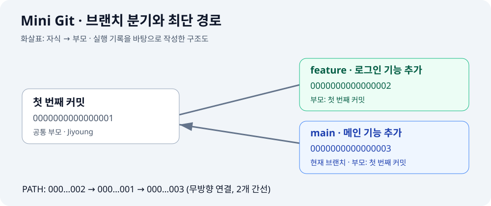

# Mini Git

커밋 메타데이터를 DAG로 관리하는 Python CLI 학습 프로젝트입니다. `5-2.pdf`의 필수 요구사항을 구현했으며 보너스인 Diff, Merge, 정렬 성능 비교는 포함하지 않습니다.

## 실행

Python 3.10 이상이 필요합니다. 외부 패키지 설치는 필요 없습니다.

```sh
python3 main.py
```

`mini-git>`에서 명령을 반복 입력합니다. `exit`, `quit`, EOF 또는 Ctrl+C로 종료합니다. 명령어 이름은 대소문자를 구분하지 않습니다. 공백을 포함한 인자는 따옴표로 감싸세요.

## 프로젝트 구성

```text
project_history/
├── main.py                  # REPL, 저장소, 그래프 탐색, 역색인, 병합 정렬
├── README.md                # 실행 방법, 실행 기록, 설계 설명
├── tests/
│   └── test_main.py         # 기능 및 알고리즘 테스트
└── docs/images/
    └── commit-graph.svg     # 실행 예시의 커밋 구조 그림
```

## 처음 실행하는 사람을 위한 순서

1. 터미널에서 이 프로젝트 폴더를 열고 `python3 main.py`를 실행합니다.
2. `mini-git>`이 나타나면 `INIT Jiyoung`으로 저장소를 초기화합니다.
3. `COMMIT "첫 번째 커밋"`으로 공통 부모가 될 커밋을 만듭니다.
4. `BRANCH feature`로 브랜치를 만들고 `SWITCH feature`로 이동합니다.
5. 로그인 커밋을 만든 뒤 `SWITCH main`으로 돌아와 메인 커밋을 만듭니다.
6. `LOG`, `SEARCH`, `ANCESTORS`, `PATH`로 결과를 확인합니다.
7. `QUIT`으로 종료하면 일반 터미널로 돌아옵니다.

`mini-git>`은 프로그램이 표시하는 프롬프트이므로 직접 입력하지 않습니다. `%` 또는 `$`가 표시되는 일반 터미널에서는 `python3 main.py`, `pwd`, 실제 Git 명령을 사용하고, `mini-git>`에서는 아래 Mini Git 명령을 사용합니다. 코드 블록의 명령은 한 줄씩 입력하고 Enter를 누르세요.

## 실행 결과 그림

아래 그림은 실행 기록을 바탕으로 작성한 커밋 구조도입니다. 실제 터미널 화면 캡처가 아닙니다.



첫 번째 커밋을 공유한 상태에서 두 브랜치가 각각 새 커밋을 만듭니다. 따라서 세 번째 커밋의 조상은 첫 번째 커밋이며, 두 번째 커밋은 조상이 아닙니다. PATH는 부모 연결을 무방향으로 보기 때문에 두 번째 → 첫 번째 → 세 번째 순서로 이동할 수 있습니다.

## 실제 실행 예시

아래는 사용자가 실행한 결과를 바탕으로 정리한 기록입니다. 명령 앞에 섞인 한글 오타와 중복 실행한 ANCESTORS/PATH는 정리했습니다. 시간은 당시 출력이며, 새로 실행하면 현재 UTC 시간으로 달라집니다. 사용자명과 터미널의 계정·장치 이름도 실행 환경에 따라 달라집니다.

```text
lee.jy@ijiyeong-ui-noteubug project_history % python3 main.py
Mini Git — type HELP for commands.
mini-git> INIT Jiyoung
Initialized repository.
Current branch: main
Current user: Jiyoung
mini-git> COMMIT "첫 번째 커밋"
[main 0000000000000001] 첫 번째 커밋
mini-git> LOG
commit 0000000000000001 (Jiyoung, 2026-10-19T01:33:48.941489+00:00) [main]
  첫 번째 커밋
mini-git> BRANCH feature
Created branch: feature
mini-git> SWITCH feature
Switched to branch: feature
mini-git> COMMIT "로그인 기능 추가"
[feature 0000000000000002] 로그인 기능 추가
mini-git> SWITCH main
Switched to branch: main
mini-git> COMMIT "메인 기능 추가"
[main 0000000000000003] 메인 기능 추가
mini-git> LOG
commit 0000000000000001 (Jiyoung, 2026-10-19T01:33:48.941489+00:00)
  첫 번째 커밋
commit 0000000000000002 (Jiyoung, 2026-10-19T01:37:13.167736+00:00) [feature]
  로그인 기능 추가
commit 0000000000000003 (Jiyoung, 2026-10-19T01:37:22.830939+00:00) [main]
  메인 기능 추가
mini-git> SEARCH "로그인"
Found 1 commit(s):
commit 0000000000000002 (Jiyoung, 2026-10-19T01:37:13.167736+00:00) [feature]
  로그인 기능 추가
mini-git> SEARCH --author=Jiyoung
Found 3 commit(s):
commit 0000000000000001 (Jiyoung, 2026-10-19T01:33:48.941489+00:00)
  첫 번째 커밋
commit 0000000000000002 (Jiyoung, 2026-10-19T01:37:13.167736+00:00) [feature]
  로그인 기능 추가
commit 0000000000000003 (Jiyoung, 2026-10-19T01:37:22.830939+00:00) [main]
  메인 기능 추가
mini-git> LOG --sort-by=date
commit 0000000000000001 (Jiyoung, 2026-10-19T01:33:48.941489+00:00)
  첫 번째 커밋
commit 0000000000000002 (Jiyoung, 2026-10-19T01:37:13.167736+00:00) [feature]
  로그인 기능 추가
commit 0000000000000003 (Jiyoung, 2026-10-19T01:37:22.830939+00:00) [main]
  메인 기능 추가
mini-git> LOG --sort-by=author
commit 0000000000000001 (Jiyoung, 2026-10-19T01:33:48.941489+00:00)
  첫 번째 커밋
commit 0000000000000002 (Jiyoung, 2026-10-19T01:37:13.167736+00:00) [feature]
  로그인 기능 추가
commit 0000000000000003 (Jiyoung, 2026-10-19T01:37:22.830939+00:00) [main]
  메인 기능 추가
mini-git> ANCESTORS 0000000000000003
commit 0000000000000001 (Jiyoung, 2026-10-19T01:33:48.941489+00:00)
  첫 번째 커밋
mini-git> PATH 0000000000000002 0000000000000003
Path: 0000000000000002->0000000000000001->0000000000000003
mini-git> QUIT
Bye!
lee.jy@ijiyeong-ui-noteubug project_history %
```

### 결과 해석

| 확인 항목 | 실행 결과와 의미 |
| --- | --- |
| 초기화 | main 브랜치와 작성자 Jiyoung이 설정됨 |
| 브랜치 분기 | feature는 두 번째 커밋, main은 세 번째 커밋을 가리킴 |
| 부모 우선 로그 | 첫 번째 커밋이 두 자식 커밋보다 먼저 출력됨 |
| 키워드 검색 | `로그인` 토큰이 포함된 두 번째 커밋만 검색됨 |
| 작성자 검색 | Jiyoung이 작성한 커밋 3개가 검색됨 |
| 날짜 정렬 | 첫 번째 → 두 번째 → 세 번째 순서로 출력됨 |
| 작성자 정렬 | 모두 같은 작성자이므로 생성 순서가 유지됨 |
| 조상 탐색 | 세 번째 커밋의 조상인 첫 번째 커밋만 출력됨 |
| 최단 경로 | 두 번째 → 첫 번째 → 세 번째, 총 2개 간선 |
| 종료 | `Bye!` 출력 후 일반 터미널로 복귀 |

커밋 옆의 `[main]`, `[feature]`는 해당 커밋을 현재 가리키는 브랜치입니다. 첫 커밋 옆의 `[main]` 표시는 main에 새 커밋을 만들면 새 커밋으로 이동합니다. 커밋 자체의 작성자나 메시지가 바뀌는 것은 아닙니다.

해시는 첫 커밋부터 증가하는 16자리 이상의 16진수이며, 한 세션에서 중복되지 않습니다. `+00:00`은 UTC를 의미하며 한국 시간은 여기에 9시간을 더한 값입니다.

## 명령어

| 명령 | 동작 |
| --- | --- |
| `INIT <user_name>` | 사용자 설정, 빈 main 브랜치 생성. 재초기화는 오류로 처리 |
| `BRANCH <branch_name>` | 현재 HEAD를 가리키는 브랜치 생성. 자동 전환 없음 |
| `SWITCH <branch_name>` | 현재 브랜치 전환 |
| `COMMIT <message>` | 현재 HEAD를 부모로 커밋 생성, HEAD·인덱스 갱신 |
| `LOG` | 모든 브랜치의 커밋을 부모가 자식보다 먼저 나오게 출력 |
| `LOG --sort-by=date` | 전체 커밋을 UTC timestamp 오름차순 출력 |
| `LOG --sort-by=author` | 전체 커밋을 작성자 이름의 사전순으로 출력 |
| `PATH <commit1> <commit2>` | 부모 연결을 무방향으로 보고 최단 경로 출력 |
| `ANCESTORS <commit_hash>` | 자신을 제외한 모든 조상을 한 번씩 출력 |
| `SEARCH <keyword>` | 역색인으로 소문자 정규화한 정확한 토큰 검색 |
| `SEARCH --author=<name>` | 작성자 이름을 대소문자까지 정확히 일치시켜 검색 |
| `HELP` | 명령어 안내 |
| `EXIT` / `QUIT` | 종료 |

키워드는 메시지를 `lower().split()`한 값입니다. 부분 문자열 검색은 하지 않으며 구두점은 유지합니다. 공백을 포함한 키워드는 모든 토큰을 포함하는 AND 검색입니다. 예를 들어 `SEARCH "add feature"`는 두 토큰이 모두 있는 커밋을 찾습니다. 같은 메시지에서 토큰이 반복되어도 결과는 중복되지 않습니다.

정렬 옵션의 값은 문서 표기대로 소문자를 사용합니다. 브랜치·사용자·해시는 대소문자를 구분합니다. 날짜·작성자 동률은 커밋 생성 순서를 유지합니다. 정렬 옵션이 있는 LOG는 해당 기준의 순서를 우선하며, 기본 LOG만 위상 순서를 보장합니다. 조상 출력 순서는 DFS 순서입니다.

잘못된 인자와 따옴표는 `Invalid args`, 없는 브랜치는 `Unknown branch: <name>`, 없는 커밋은 `Unknown commit: <hash>`로 안내합니다. 경로가 없으면 `No path`, 조상이 없으면 `No ancestors`, 빈 로그는 `No commits`가 나옵니다. 오류 후에도 REPL은 계속 실행됩니다.

## 구조와 알고리즘

구현은 제출과 실행을 간편하게 하도록 `main.py`에 모았습니다. 알고리즘은 독립된 함수·클래스로 분리되어 있습니다.

- `Commit`: hash, message, author, timestamp, parents를 가진 불변 노드. 부모는 튜플이며 0개 이상의 부모를 표현할 수 있습니다. 필수 COMMIT 명령은 부모를 0개 또는 1개 생성합니다.
- `MiniGit`: 해시맵 기반 커밋 저장소, 브랜치별 HEAD, 현재 브랜치와 사용자를 관리합니다. 부모는 이미 존재하는 커밋만 가리키고 기존 노드를 변경하지 않으므로 순환이 생기지 않는 DAG입니다.
- `topological_order`: Kahn 알고리즘으로 진입 차수가 0인 커밋부터 출력합니다. 전체 그래프의 부모가 반드시 자식보다 먼저 나옵니다. 시간·공간은 O(V+E)입니다.
- `shortest_path`: 부모·자식 양쪽을 기록한 인접 집합에서 BFS를 수행합니다. BFS는 간선 수가 최소인 경로를 찾습니다. 이웃 해시를 직접 구현한 병합 정렬로 정렬하여 방문하므로 동률 경로 중 경로 문자열의 사전순이 가장 작은 경로를 선택합니다. 생성 해시는 구분자보다 큰 16진수 문자로만 구성됩니다. 시간은 O(V+E+Σ d(v) log d(v)), 보조 공간은 O(V+E) 이내입니다.
- `ancestors`: 반복형 DFS와 방문 집합을 사용합니다. 공통 조상을 중복 출력하지 않고 깊은 이력에서도 재귀 제한에 걸리지 않습니다. 도달 가능한 부분 그래프에서 O(V+E) 시간, O(V+E) 이내 공간입니다.
- `merge_sort`: 바닥부터 병합하는 안정 정렬입니다. 평균·최악 모두 O(n log n), 보조 공간 O(n)입니다. 동률이면 왼쪽 원소를 먼저 선택해 안정성을 보장합니다. 키 함수를 바꿔 날짜·작성자 기준을 지원합니다. `sorted()`와 `list.sort()`는 사용하지 않습니다.
- `InvertedIndex`: `keyword -> hash 목록`, `author -> hash 목록`을 커밋 시 갱신합니다. 해시맵 조회는 평균 O(1), 단일 토큰/작성자 결과 복사는 O(k)입니다. 모든 N개 커밋의 메시지를 순회하는 검색 대신 일치하는 게시 목록만 읽습니다. 다중 토큰은 해당 게시 목록들의 교집합을 구하므로 목록 길이 합에 비례합니다.

파일 내용 추적, 네트워크, 저장 파일은 구현하지 않습니다. 종료하면 메모리 데이터는 사라집니다. INIT은 현재 세션의 작성자를 한 번 설정합니다.

## 검증

```sh
python3 -m unittest discover -s tests -v
```

브랜치 분기와 HEAD, 검색 인덱스, 위상 순서, 정렬 안정성, 최단 경로의 사전순 동률 처리, 분리된 그래프, 공통 조상 중복 제거, 잘못된 입력, 1,000개 커밋의 해시 유일성과 조상 탐색을 검증합니다. 다중 부모 그래프는 알고리즘 단위 검증에만 사용하며 Merge 명령은 구현하지 않습니다.

## 자주 만나는 상황

| 화면 또는 상황 | 이유와 해결 방법 |
| --- | --- |
| `mini-git>`만 표시됨 | 정상입니다. 명령 입력을 기다리는 중입니다. |
| `Repository not initialized` | 먼저 `INIT Jiyoung`을 실행하세요. |
| `Invalid args` | 인자 개수, 따옴표, 옵션을 확인하세요. 공백이 있는 메시지는 따옴표로 감쌉니다. REPL은 실제 입력도 표시합니다. |
| `Unknown command: PWD` | Mini Git 안에서 터미널 명령을 입력한 상태입니다. `QUIT` 후 `pwd`를 사용하세요. |
| 다시 켰더니 기록이 없음 | 메모리 기반 프로그램이므로 정상입니다. INIT부터 다시 실행하세요. |
| `LOG --sort-by=author` 결과가 날짜순과 같음 | 작성자가 모두 같으면 안정 정렬에 의해 생성 순서가 유지됩니다. |
| `No path` | 두 커밋이 서로 연결되지 않은 별도의 루트에서 시작한 경우입니다. |

## 구현 범위와 제출 파일

필수 제출 파일은 `main.py`, `README.md`입니다. 검증을 위한 `tests/`와 README에서 사용하는 `docs/images/`도 함께 저장소에 포함하세요. Diff, Merge, 여러 정렬 알고리즘의 성능 비교는 선택 보너스이므로 구현 범위에서 제외했습니다.

실제 GitHub 업로드는 Mini Git에서 `QUIT`으로 나온 뒤 일반 터미널에서 수행합니다. 이 프로그램의 COMMIT은 실제 Git 커밋이나 파일 백업을 생성하지 않습니다.
